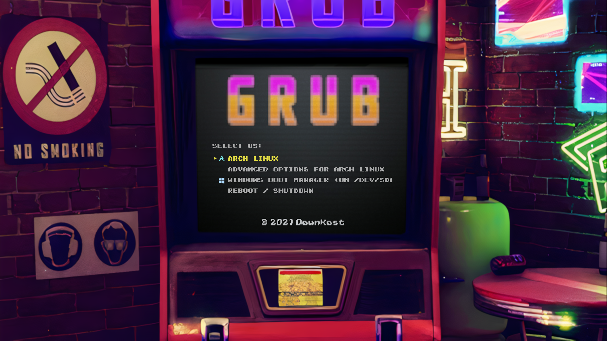

# dotfile
### Hey stranger, welcome to my linux dotfiles


## GRUB Theme (Only 1920x1080 sorry...)




### Here is a quick guide on how to apply my custom GRUB Arcade theme

#### First you download the grub-customizer

*Debian/Ubuntu* 
  ``` 
  sudo apt-get install grub-customizer 
  ```
*Arch/Manjaro* ([AUR](https://wiki.archlinux.org/title/Arch_User_Repository)): 
<br>
https://aur.archlinux.org/packages/grub-customizer
<br>

For any other distro or errors check the [oficial guide](https://launchpad.net/grub-customizer)
#### Move the Arcade folder to your grub themes folder
Mine is:
> /boot/grub/themes/

*Yours can be different, please check your distro wiki*
#### Then open the grub-customizer
Go to the 
> Appearence > Settings > Theme > Arcade > Save (Ctrl + S)

*The Arcade theme should appear in that list*

#### After you saved the theme, you're done!
**Congratulations you now have the Arcade Grub theme, reboot your pc to see it**
